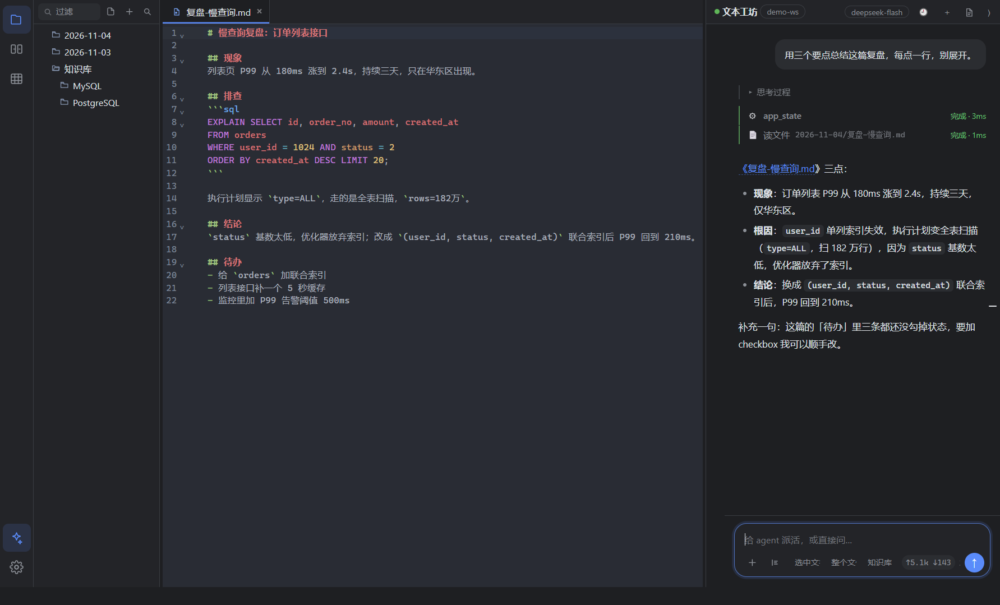

# TextHarness（文本工坊）

本地优先的轻量文本编辑器，右侧内嵌一个**能直接读写工作区的 agent**——不是聊天框贴代码，而是自己列目录、读文件、写文件、搜索、在编辑器里打开结果。



---

## 快速开始

| 场景 | 命令 | 产物 |
|---|---|---|
| 开发（热更新） | `npm run dev` | — |
| 跑构建产物 | `npm run build && npm start` | — |
| 免安装目录版 | `npm run pack` | `release/win-unpacked/TextHarness.exe` |
| **Windows 安装包** | `npm run dist` | `release/TextHarness-<版本>-setup.exe`（约 77 MB） |
| **macOS 包**（需 macOS） | `npm run dist:mac` | `release/*.dmg` + `*.zip`（arm64 + x64） |
| Linux AppImage | `npm run dist:linux` | `release/*.AppImage` |

安装包是 NSIS 向导：可改安装目录、创建桌面/开始菜单快捷方式，默认装到
`%LOCALAPPDATA%\Programs\TextHarness`。

> 图标在 `build/icon.ico`（由 `scripts/make-icon.py` 生成，需要 Pillow）。
> 打包时 `iconv-lite` 会被打进主进程 bundle，所以安装后不依赖 node_modules。

## macOS 支持

代码本身已经是跨平台的（Electron + CodeMirror），已经处理掉的差异：

| 差异点 | 处理 |
|---|---|
| 路径分隔符 | 不再硬编码 `\`，按路径自身推断（`joinPath` / `resolveRelPath`） |
| 快捷键 | 统一用 `ctrlKey \|\| metaKey`，欢迎页文案按平台显示 `Cmd` / `Ctrl` |
| 窗口关闭行为 | `window-all-closed` 在 macOS 上不退出（保持 dock 常驻） |
| 数据目录 | 自动用 `~/Library/Application Support/TextHarness` |
| 卸载 | macOS 没有卸载程序，拖到废纸篓即可；卸载不删配置 |

**但 `.dmg` 不能在 Windows 上构建**——打包 dmg 依赖 macOS 的 `hdiutil`，Apple 的工具链不跨平台。
两条路：

1. **在 Mac 上**（最快）：`npm install && npm run dist:mac`
2. **用 GitHub Actions**：仓库里已放好 `.github/workflows/build.yml`，
   push tag 或手动触发即可在 `macos-14` runner 上出 `dmg + zip`（arm64 / x64），产物在 Actions artifacts 里。

> **Gatekeeper 提醒**：没有 Apple 开发者证书时打出来的包未签名，别人 Mac 上双击会被拦。
> 临时办法：右键 →「打开」，或 `xattr -dr com.apple.quarantine /Applications/TextHarness.app`。
> 要正式分发需要 Apple Developer 账号（$99/年）做 codesign + notarize，配 `CSC_LINK` / `APPLE_ID` 等环境变量。

### 一条命令发版

```powershell
npm run release -- 0.3.1            # 完整流程
npm run release -- 0.3.1 --skip-build   # 复用 release/ 里已有的 exe
npm run release -- 0.3.1 --no-site     # 不更新官网
```

脚本 `scripts/release.mjs`（配套服务端 `scripts/release-server.sh`）按顺序做：

| 步骤 | 动作 |
|---|---|
| 1 | 改 `package.json` 版本号 |
| 2 | `npm run dist` 打 Windows 安装包，算 sha256 |
| 3 | 本地 `git commit`，`git archive` 打源码 tar |
| 4 | tar + 安装包 + 服务端脚本 `scp` 到生产机 |
| 5 | **在服务器上** `git push` → 打 tag → 轮询 Actions 等 macOS dmg（本机 `git push` 在受限环境里跑不通，所以推送放服务器） |
| 6 | 服务器下载 artifacts、解出 dmg 放进 `/var/www/textharness/downloads/` |
| 7 | 渲染 `site/index.html` 模板（`{{VERSION}}` / `{{EXE_SHA}}` 等占位符）并部署 |

前置条件：

- `C:\Users\lizhongzheng\Desktop\github.txt` 里放 GitHub PAT（细粒度：`Contents: Read and write`）
- `deploy/keys/deploy_ed25519` 能免密登录 `root@47.109.100.9`
- 都可用环境变量覆盖：`GH_TOKEN_FILE`、`DEPLOY_HOST`、`DEPLOY_KEY`

> 官网 `site/index.html` 现在是**模板**，里面是 `{{VERSION}}`、`{{EXE_SIZE}}`、`{{ARM_SHA}}` 这类占位符；
> 部署时由脚本渲染成正式页面传到服务器（不会把占位符发上线，脚本会检查残留）。

### 自测脚本

```powershell
node scripts/selftest.mjs        # 编码往返 + 图片路径（23 项）
node scripts/setup-test-workspace.mjs  # 造一个测试工作区
node scripts/ui-agent-test.mjs   # 用 CDP 在真实界面里跑一次 agent（需先启动带 --remote-debugging-port 的应用）
```

---

## Agent 的工作区

**工作区 = 设置里的工作根目录**（默认 `文档/TextHarness`）。日期文件夹、图片图库都在它下面：

```
<工作区>/
├─ 2026-10-27/            ← agent 和编辑器共用的日期目录
│  ├─ 慢查询排查.sql
│  └─ agent-summary.md    ← agent 写的
├─ .assets/img/2026-10-27/ ← 粘贴图片自动入库
└─ .history/               ← agent 覆盖文件前的自动备份
```

所有工具路径都用 `assertInside` 限制在工作区内，越界直接拒绝。

### 工具清单

| 工具 | 作用 | 备注 |
|---|---|---|
| `list_dir` | 列目录（文件/大小/日期） | 自动排序，目录优先 |
| `read_file` | 按行读文本，带行号 | 支持 offset/limit，自动识别编码，二进制拒读 |
| `write_file` | 写文件，不存在则建 | **覆盖前自动备份到 `.history/`** |
| `search_files` | 正则搜索工作区 | 返回 `文件:行号: 内容`，跳过二进制/超大文件 |
| `open_in_editor` | 在编辑器里打开文件 | 用户可见，自动切 Tab |

Agent 循环最多 8 步，超过会停下来报错（防止模型打转烧 token）。

---

## 定时任务

面板里可以挂后台任务，到点自动跑一次 agent，不需要人盯着。默认带一个：

| 任务 | 触发 | 做什么 |
|---|---|---|
| **草稿知识整理** | 应用闲置 **60 分钟** | 扫最近 7 天的草稿，把知识点拆成条目写进 `知识库/` |

触发语义有三种，同时生效：

1. **闲置触发**：连续 60 分钟没有任何交互（点击/按键/窗口聚焦）。
2. **启动补跑**：应用关着/闲置超过阈值时，下次打开 90 秒后补一次（可在配置里关）。
3. **每天定时**：任务支持 `{ kind: 'daily', time: '09:00' }`，但默认任务不用这个。

> 应用完全退出时是跑不了的——Electron 进程没了。所以"关了一小时"的实际行为是：**下次打开 90 秒后补跑**。

### 安全边界（这是重点）

这类无人值守的写操作最怕"把用户原稿改坏"，所以从工具层面就掐死了：

| 限制 | 实现 |
|---|---|
| 只能读 + 新建 | 任务只拿到 `list_dir` / `read_file` / `search_files` / `write_new_file` 四个工具，`write_file`、`open_in_editor` 根本不在工具表里 |
| 不能覆盖 | `write_new_file` 发现目标已存在直接返回失败，让模型换文件名 |
| 不留垃圾 | 找不到草稿就要求直接回答"没有需要整理的草稿"，不创建任何文件 |
| 可追溯 | 每次运行追加一行到 `.tasks/run.log`，含新建文件清单 |

### 产物长这样

```
<工作区>/
├─ 2026-10-27/                     ← 原稿，一个字节都没动（跑完做了哈希比对）
├─ 知识库/
│  ├─ 索引.md                       ← 本次新增条目，带相对链接
│  ├─ PostgreSQL/
│  │  ├─ 组合索引设计三原则.md        > 来源：2026-10-27/索引使用建议.md（第 3 行附近）
│  │  └─ pg_stat_statements-慢查询排查.md
│  └─ 运维排错/
│     └─ DBA上线前检查清单.md
└─ .tasks/run.log                   ← 运行记录
```

手动运行：设置 →「定时任务」→ 立即运行。实测一次跑完约 30 秒，生成 3 篇条目 + 索引。

---

## 对话面板风格

对齐 DeepSeek Harness 的文档式对话观感，而不是常见聊天软件的"气泡流"：

| 元素 | 处理 |
|---|---|
| 助手输出 | 无容器、无头像，直接是文档：`##` 真标题、有序/无序列表、段落间距 |
| 用户消息 | 右对齐、浅色圆角块（无尾巴、无边框） |
| 代码块 | 独立卡片，顶部一条 "SQL / 复制" 标题栏，代码自动折行 |
| 输入框 | 圆角大卡片，聚焦有光晕；内含 ＋（插入选区）、上下文 chip、步数、圆形 ↑ 发送 |
| 工具调用 | 扁平行 + 左侧 2px 状态条（运行中脉冲 / 完成绿 / 失败红），点击展开返回内容 |
| 思考过程 | 折叠成左侧细线小块，默认收起 |
| 滚动 | 离开底部时浮现圆形"回到底部"按钮 |

深色/浅色两套都调过（设置里切换），浅色下和 DSH 的观感基本一致。

---

## 编辑体验

- **默认保存到当日目录**：未命名文档 `Ctrl+S` 直接落到 `<工作区>/<今天>/<标题>`，
  不弹保存对话框；同名自动加 `-2`、`-3`。要换位置用 `Ctrl+Shift+S`。
- **列选择（列模式）**：点右下角「列」开启，或按住 `Alt` 拖拽。
  开启后编辑器会画出纵向参考线（每 4 个字符一条），拖出的矩形以实心块显示；
  可整列复制，粘贴时按行分发到每个光标。
- 多光标、矩形选择、列粘贴都基于 CodeMirror 6 的 multi-range selection。

> 实测：框选 3 行 4 列 → 复制得到 `"AAAA\nBBBB\nCCC"` → 粘贴按行插入 3 个位置。

---

## 功能状态

| 模块 | 状态 | 说明 |
|---|---|---|
| 三栏布局 | ✅ | 左右分隔线可拖，宽度写配置；两侧可折叠 |
| 多标签 | ✅ | 脏标记、关闭确认、双击顶部空白新建 |
| 编辑器内核 | ✅ | CodeMirror 6，SQL/JSON/Markdown 高亮、折叠、正则查找替换 |
| 编码 | ✅ | UTF-8 / BOM / GBK / UTF-16 自动识别，保存前检测丢字 |
| 换行符 | ✅ | CRLF / LF 识别、切换、原样还原 |
| 粘贴图片 | ✅ | 存 `.assets/img/<日期>/`，插入 md 链接，悬停预览；图库目录在「设置」里可见并可一键打开，左侧树不显示 |
| 文件树 | ✅ | 增删改名、折叠、过滤、资源管理器定位 |
| **Agent 工具循环** | ✅ | 流式输出 + 工具卡片 + 多步推理 |
| **Agent 回写编辑器** | ✅ | 写完自动在编辑器打开；回复可一键插入光标 |
| **定时任务** | ✅ | 闲置触发 / 启动补跑，工具白名单限定"只读 + 只新建" |
| **模型选择器** | ✅ | 点标题栏模型名切换，实时拉网关 `/models`（当前 113 个），带搜索过滤 |
| **大文件保护** | ✅ | >8 MB 弹提示，可只读加载前 3 MB；保存时强制另存为，不覆盖原文件 |
| **外部变更提醒** | ✅ | 每 4 秒检测：文件被别的程序改了 → 问是否重新加载；被删了 → 问是否保留内容 |
| **文件夹搜索/替换** | ✅ | `Ctrl+Shift+F`，支持正则/大小写/全词；替换前自动备份到 `.history/` |
| **快速打开** | ✅ | `Ctrl+P` 模糊匹配文件名，↑↓ 选择、回车打开 |
| **查找替换面板** | ✅ | `Ctrl+F`，自绘中文面板：匹配计数、Aa/正则/全词开关、替换/全部替换 |
| **标签页恢复** | ✅ | 重开应用自动还原上次的标签和活动标签 |
| **标签右键菜单** | ✅ | 关闭/关闭其他/左右两侧/未修改、保存、另存为、重命名、重新加载、资源管理器定位、复制路径、移到回收站 |
| **崩溃恢复** | ✅ | 每 10 秒快照未保存内容；异常退出后启动会提示并还原（含未保存修改） |
| 内嵌 Harness 页面 | ❌ | 已移除，统一走自研 agent 面板 |
| 会话持久化 | ✅ | 每次对话落盘，重启自动恢复，头部 🕘 可切历史会话 |
| 悬浮面板 / 分屏 / 大文件模式 | ❌ | 未做 |

---

## 模型接入

**显式配置，不做任何自动发现。** 首次打开面板会提示「先接一个模型」，点按钮进设置填三项：

| 配置项 | 必填 | 默认值 |
|---|---|---|
| Base URL | 否 | `https://api.deepseek.com/v1` |
| 模型名 | 否 | `deepseek-chat` |
| API Key | **是** | — |

也可以走环境变量（方便 CI / 无界面场景）：

```powershell
$env:TEXTHARNESS_API_KEY = "sk-..."
$env:TEXTHARNESS_BASE_URL = "https://api.deepseek.com/v1"   # 可选
$env:TEXTHARNESS_MODEL   = "deepseek-chat"                  # 可选
```

> 早先版本会去扫描 `~/.dsh` 自动复用 DeepSeek Harness 的凭据。这个行为已移除：
> 大多数机器上根本没有那个目录，隐式读取别的软件凭据既不可预期也不安全。

配置好后点标题栏的模型名可以切换模型，列表来自网关的 `GET /models`；接口不可用时退回按服务商推断的内置清单。

这个模型会先输出 `reasoning_content`（思考过程）再输出正文，UI 里折叠在「思考过程」中。

---

## 关键设计决策（都是踩过的坑）

0. **每篇文档的 `EditorState` 必须实时回写**
   单 `EditorView` + 每文档一份 `EditorState` 的模型下，编辑只会更新 `view.state`。
   最初没把最新 state 写回 `doc.state`，导致两个致命问题：**保存出来是 0 字节**、
   **切走标签再切回来内容被还原**。现在 `updateListener` 里每次都回写，
   切标签前也会先把 `view.state` 存回上一篇。

1. **GBK 解码用 gb18030、编码用 gbk(CP936)**
   gb18030 是 Unicode 全集，emoji 能编成 4 字节；但文件对外标注是 GBK，老工具读出来就是乱码。所以解码宽松、编码严格，保存前 dry-run 检测丢字。

2. **图片相对路径按"文档所在目录"算**
   markdown 渲染器是按文档位置解析图片的，未命名文档按当日目录算，正好能和默认保存位置对上。

3. **`[hidden]` 要显式 `display:none !important`**
   作者 CSS 的 `display:flex` 会盖掉 `hidden` 属性，"内嵌模式提示"会叠在聊天区上。

4. **配置读写要容忍 UTF-8 BOM**
   PowerShell 的 `Set-Content -Encoding UTF8` 会写 BOM，`JSON.parse` 直接抛错 → 配置静默回落默认值。这个坑实际踩过一次，表现为"工作区设置不生效"。

5. **工作区要做可写探测**
   Windows 的「受控文件夹访问」会拦未签名程序写 `Documents`，`mkdir` 报 EPERM。现在会探测可写性，失败自动退到 `userData/workspace`。

6. **agent 写文件前先备份**
   模型是会犯错的，覆盖前把原文件复制到 `.history/<时间戳>__<文件名>`，给用户留后路。

7. **流式请求放主进程**
   渲染进程 fetch 受 CORS 限制，主进程 Node fetch 不受限；SSE 解析后按增量推给 UI。

---

## 环境注意事项

从 DSH / Electron 宿主的终端里启动时会遇到（普通桌面不会）：

| 现象 | 原因 | 处理 |
|---|---|---|
| 启动即退出，`require('electron')` 返回字符串 | 宿主设了 `ELECTRON_RUN_AS_NODE=1` | `Remove-Item Env:ELECTRON_RUN_AS_NODE` |
| 启动崩溃（crashpad/沙箱） | 嵌套 Chromium 沙箱 | 加 `--no-sandbox` |
| 秒退 | 单实例锁依赖命名管道 | 设 `TH_NO_SINGLE_INSTANCE=1` |
| 构建报 `Access is denied` | esbuild 临时目录不可写 | 把 `$env:TEMP` 指到工作区内 |
| 打包版双击后进程秒退、无窗口无日志 | 所在目录被 ACL 限制（如 DSH 沙箱工作区带 `Everyone: Deny DeleteSubdirectoriesAndFiles`），**与中文路径无关** | 搬到不受限目录；程序内有 `did-fail-load` 提示 |

---

## 目录结构

```
src/
├─ main/
│  ├─ index.ts          入口、窗口、th-asset 协议、退出保护
│  ├─ ipc.ts            IPC（含 agent 流式事件转发）
│  └─ services/
│     ├─ agent.ts       ★ agent 循环：模型 → 工具 → 模型
│     ├─ tools.ts       ★ 工具实现 + 工作区沙箱
│     ├─ llm.ts         模型配置发现 + SSE 解析
│     ├─ sessions.ts    ★ 会话持久化（userData/sessions/*.json）
│     ├─ tasks.ts       定时任务调度
│     ├─ encoding.ts    BOM/EOL/GBK 探测与往返
│     ├─ files.ts       读写、树、增删改、越界校验
│     ├─ assets.ts      图片落盘与相对路径
│     └─ config.ts      配置持久化 + 工作区可写探测
├─ preload/index.ts     主界面 API 白名单
├─ renderer/src/        main / editor / tree / aiChat / dialogs
└─ shared/              主/渲染共享类型
```

---

## 下一步

1. 文件 diff 展示：agent 改文件时显示增删行。
2. 写文件前的确认弹窗（现在是自动备份 + 直接写）。
3. 让 agent 能直接改编辑器里的当前缓冲区（而不只是落盘）。
4. 大文件只读模式。
